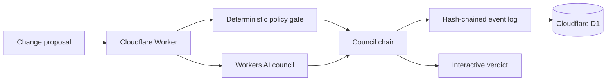

# CloudCourt

**Put cloud changes on trial.**

CloudCourt is an independent multi-agent architecture review experiment by Nishant Gupta. Seven specialist agents review the same AWS, Azure or multi-cloud proposal, cast private votes, and produce a council decision. A deterministic policy gate holds the veto, while every decision event is linked into a SHA-256 evidence chain.

## The research question

Does a multi-agent council identify materially more cloud risk than a single architecture model, or does it merely produce more discussion?

CloudCourt records both results so the difference can be measured rather than assumed.

## Council

- Security
- Identity and Access
- Network
- Site Reliability
- FinOps
- Compliance
- Platform Architecture

## Architecture



The agents provide specialized judgment. Code owns mandatory controls and the final veto. D1 stores the case and event chain. The public UI never asks for cloud credentials and warns users to submit only synthetic or sanitized designs.

Each specialist receives the complete proposal, a domain-specific review rubric and only relevant heuristic policy hints. FinOps assesses cost drivers and spend evidence; Reliability assesses availability, restoration and rollback. The single-reviewer baseline assesses all seven domains. Missing details are treated as unknowns, and public API ingress is distinguished from an exposed data service. The policy gate still evaluates every finding for the final decision.

The council uses seven separate role-prompted calls to the same model, with no access to other reviewers' votes. It does not implement a debate round or independent model diversity. Comparing one run's votes is exploratory; proving better risk detection requires a labelled evaluation set. Every result records whether it came from Workers AI or the rules fallback.

## Run locally

```bash
npm install
npm run db:local
npm run dev
```

Wrangler runs a local D1 database. Without a working Workers AI binding, the application intentionally falls back to deterministic specialist reviews so the UI remains testable.

## Deploy

1. Authenticate Wrangler: `npx wrangler login`
2. Create D1: `npx wrangler d1 create cloudcourt-db`
3. Replace the placeholder `database_id` in `wrangler.jsonc`.
4. Apply the schema: `npm run db:remote`
5. Deploy: `npm run deploy`
6. Attach `cloudcourt.azureagent.co` as a Cloudflare Worker custom domain.

## Guardrails

- 6,000-character proposal limit
- No user-supplied credentials required
- Deterministic veto for critical policy failures
- Structured, validated reviewer output with safe fallback
- Hash-linked audit events
- Sanitized/public scenarios only

## Status

Research prototype. CloudCourt is not production approval, legal advice, compliance certification or a substitute for professional security review.

## License

MIT
